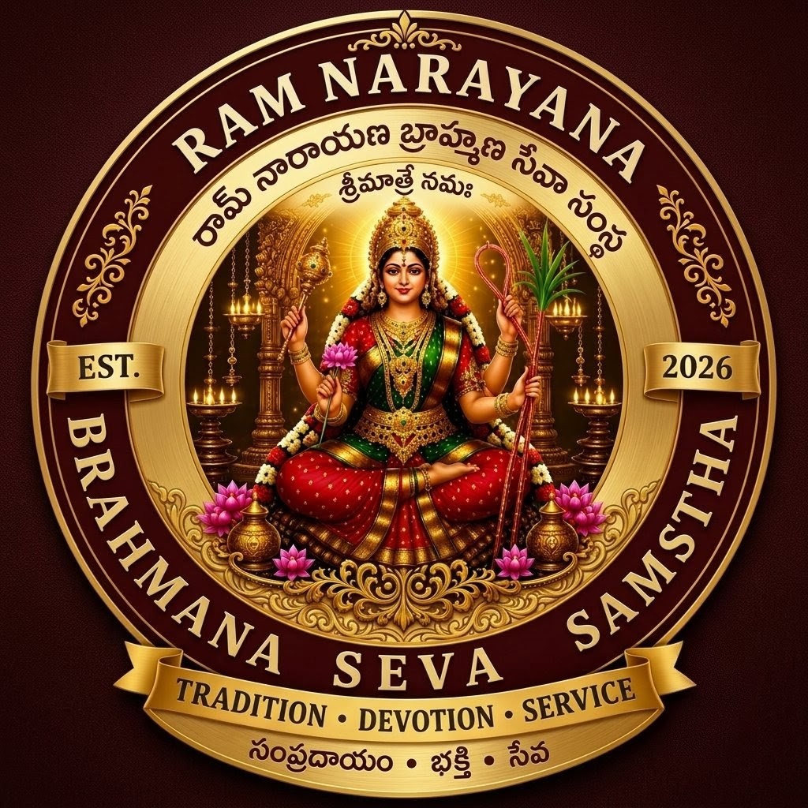

<div align="center">

  <!-- Official Sacred Emblem -->
  

  # 🕉️ రామ్ నారాయణ బ్రాహ్మణ సేవా సంస్థ
  ### **Ram Narayana Brahmana Seva Samstha**
  *దిల్‌సుఖ్‌నగర్, హైదరాబాద్ • Dilsukhnagar, Hyderabad, Telangana*

  <p align="center">
    <strong>"వైదిక సంప్రదాయ పరిరక్షణే మా లక్ష్యం — శ్రద్ధ, భక్తి, శాస్త్రబద్ధతతో మీ సేవా తత్పరతలో..."</strong><br>
    <em>దివ్య పర్యవేక్షణ & మార్గదర్శకత్వం: <strong>ప్రొ॥ నంబూరి ఆదినారాయణ శర్మ</strong> (Pro. Namburi Adinarayana Sharma)</em><br>
    📍 H.No. 11-62, ప్రగతి నగర్ రోడ్, సాహితి నగర్, దిల్‌సుఖ్‌నగర్, హైదరాబాద్ – 500060
  </p>

  <!-- Key Sacred Badges -->
  <p align="center">
    <a href="https://ram-narayana-brahmana-seva-samstha.vercel.app/" target="_blank">
      
    </a>
    <a href="https://maps.app.goo.gl/kL4BedYNx17JEaZs9?g_st=aw" target="_blank">
      
    </a>
    <a href="https://www.instagram.com/ramnarayana_brahmana_seva?xtok=MTAwMWFiY245OWJrcQ==" target="_blank">
      
    </a>
    <a href="https://www.facebook.com/profile.php?id=61595183055843" target="_blank">
      
    </a>
    <a href="https://www.youtube.com/@RamNarayanaBrahmanaSevaSamstha" target="_blank">
      
    </a>
    <a href="https://wa.me/917780223977?text=నమస్కారం%20రామ్%20నారాయణ%20బ్రాహ్మణ%20సేవా%20సంస్థ,%20నేను%20మీ%20సేవల%20గురించి%20తెలుసుకోవాలనుకుంటున్నాను." target="_blank">
      
    </a>
  </p>

  <!-- Samstha Highlights -->
  <p align="center">
    
    
    
    
  </p>

</div>

---

## 📑 విషయ సూచిక | Table of Contents

1. [🏛️ సంస్థ పరిచయం & పూర్వరంగం | About the Samstha](#️-సంస్థ-పరిచయం--పూర్వరంగం--about-the-samstha)
2. [🎯 ధ్యేయం & ప్రధాన ఆశయాలు | Sacred Mission & Vision](#-ధ్యేయం--ప్రధాన-ఆశయాలు--sacred-mission--vision)
3. [🕉️ సమగ్ర సేవా విభాగాలు | Sacred Services in Detail](#️-సమగ్ర-సేవా-విభాగాలు--sacred-services-in-detail)
4. [🔄 సంస్థలో కార్యక్రమ నిర్వహణ విధానం | Step-by-Step Ritual Process](#-సంస్థలో-కార్యక్రమ-నిర్వహణ-విధానం--step-by-step-ritual-process)
5. [🌿 పితృ కర్మల మహత్యం & శుభఫలాలు | Spiritual Significance & Benefits of Shraddha](#-పితృ-కర్మల-మహత్యం--శుభఫలాలు--spiritual-significance--benefits-of-shraddha)
6. [🌟 మా సంస్థ ప్రత్యేకతలు | Why Families Choose Our Samstha](#-మా-సంస్థ-ప్రత్యేకతలు--why-families-choose-our-samstha)
7. [🏢 ప్రాంగణ సౌకర్యాలు & పరిశుభ్రత | Premises & Sacred Facilities](#-ప్రాంగణ-సౌకర్యాలు--పరిశుభ్రత--premises--sacred-facilities)
8. [📋 కుటుంబాలకు ముఖ్యమైన సూచనలు | Guidelines for Visiting Families](#-కుటుంబాలకు-ముఖ్యమైన-సూచనలు--guidelines-for-visiting-families)
9. [❓ తరచుగా అడిగే ప్రశ్నలు | Frequently Asked Questions (FAQ)](#-తరచుగా-అడిగే-ప్రశ్నలు--frequently-asked-questions-faq)
10. [🌐 సోషల్ మీడియాలో ఫాలో అవ్వండి | Follow Us On Social Media](#-సోషల్-మీడియాలో-ఫాలో-అవ్వండి--follow-us-on-social-media)
11. [📍 సంప్రదింపు వివరాలు & దర్శన సమయాలు | Contact & Location Info](#-సంప్రదింపు-వివరాలు--దర్శన-సమయాలు--contact--location-info)

---

## 🏛️ సంస్థ పరిచయం & పూర్వరంగం | About the Samstha

### **తెలుగు:**
**రామ్ నారాయణ బ్రాహ్మణ సేవా సంస్థ** అనేది సనాతన ధర్మం నిర్దేశించిన పితృ యజ్ఞాలను, శ్రాద్ధ కర్మలను పరమ పవిత్రంగా, నిష్ఠాగరిష్ఠంగా నిర్వహించేందుకు అంకితమైన ఆధ్యాత్మిక సేవా సంస్థ. ఈ పుణ్య సంస్థ తెలంగాణ రాష్ట్ర రాజధాని అయిన హైదరాబాద్‌లోని ప్రముఖ ఆధ్యాత్మిక మరియు కేంద్ర ప్రదేశమైన **దిల్‌సుఖ్‌నగర్** లో (H.No. 11-62, ప్రగతి నగర్ రోడ్, సాహితి నగర్) శాశ్వత భవనంలో కొలువై ఉన్నది.

ఈ సంస్థ ప్రముఖ వేద పండితులు, ఆచార్యులు అయిన **ప్రొ॥ నంబూరి ఆదినారాయణ శర్మ** గారి దివ్య పర్యవేక్షణ మరియు అనుభవజ్ఞులైన వేద విద్వాంసుల మార్గదర్శకత్వంలో నడుస్తున్నది.

#### **సంస్థ ఆవిర్భావ నేపథ్యం:**
నేటి మహానగర జీవనంలో, ముఖ్యంగా అపార్ట్‌మెంట్లు మరియు గేటెడ్ విల్లాలలో నివసించే కుటుంబాలు పితృ కర్మలను తమ గృహాలలో నిర్వహించడంలో ఎదుర్కొంటున్న వాస్తవ సమస్యలు:
* అపార్ట్‌మెంట్లలో హోమాలు జరపడానికి, పొగ రాకుండా ఉండేందుకు గల కఠినమైన ఆంక్షలు.
* నిత్య సంధ్యావందనం ఆచరించే నిష్ఠాగరిష్ఠులైన సత్ బ్రాహ్మణ భోక్తలు సమయానికి లభించకపోవడం.
* శ్రాద్ధ కర్మలకు అవసరమైన కఠినమైన 'మడి' ఆచారంతో కూడిన సాత్విక వంటను తయారుచేసుకోవడంలో శ్రమ.
* దర్భలు, సమిధలు, ఆవు నెయ్యి, నల్ల నువ్వులు, విస్తళ్ళు మొదలైన ప్రామాణిక పూజా ద్రవ్యాల సేకరణలో ఇబ్బందులు.

ఈ సమస్యలన్నింటికీ సంపూర్ణ పరిష్కారంగా — పూర్వీకుల రుణం తీర్చుకునే పవిత్ర కర్తవ్యాన్ని ఏ విధమైన ఆటంకం లేకుండా, కుటుంబ సభ్యులందరూ కలిసి భక్తిశ్రద్ధలతో నిర్వహించుకోవడానికి **రామ్ నారాయణ బ్రాహ్మణ సేవా సంస్థ ఒక పవిత్ర వేదికను** అందిస్తున్నది.

---

### **English:**
**Ram Narayana Brahmana Seva Samstha** is a premier Vedic institution founded with the sole purpose of upholding Sanatana Dharma and conducting sacred Hindu ancestral rites (Pitru Karyas & Shraddha ceremonies) with uncompromised Shastric precision. 

Located in **Dilsukhnagar, Hyderabad, Telangana**, the Samstha functions under the revered guidance and Vedic direction of **Pro. Namburi Adinarayana Sharma**.

Modern city living presents immense hurdles for families wishing to fulfill their filial duties (Pitru Rina): lack of spacious ventilated areas for fire rituals (Homas) in apartments, difficulty in securing pious Brahmin Bhokthas who adhere to strict daily Sandhyavandana practices, and the logistical challenge of preparing orthodox Satvik food. 

**Ram Narayana Brahmana Seva Samstha solves all of these challenges under one sacred roof — providing the venue, Vedic Pandits, devout Bhokthas, authentic puja items, and pure Satvik meals.**

---

## 🎯 ధ్యేయం & ప్రధాన ఆశయాలు | Sacred Mission & Vision

> ### *"మాతాపితరుల రుణం తీర్చుకోవడం ప్రతి మానవుని ప్రథమ కర్తవ్యం. పూర్వీకుల ఆశీస్సులే కుటుంబ క్షేమానికి, సకల శుభాలకు మూలస్తంభాలు."*
> — **ప్రొ॥ నంబూరి ఆదినారాయణ శర్మ**

1. **వేదోక్త ఆచరణ (Vedic Rigor):** ప్రాచీన బోధాయన, ఆపస్తంబ గృహ్య సూత్రాల ప్రకారం ఒక్క అక్షరం కూడా పొల్లుపోకుండా పితృ యజ్ఞాలను జరిపించడం.
2. **సదాచార సంరక్షణ (Devout Sadacharam):** ఆచార సంపన్నులైన, నిత్య గాయత్రీ జప నిష్ఠ గల వేద బ్రాహ్మణుల ద్వారా మాత్రమే భోక్తల సేవ మరియు హోమాలు జరిపించడం.
3. **కుటుంబాలకు మానసిక ప్రశాంతత (Spiritual Peace of Mind):** పూజా సామాగ్రి సేకరణ మొదలుకొని భోజనం వరకు అన్ని బాధ్యతలను సంస్థే వహించి, కర్త నిర్మల మనస్సుతో కర్మను పూర్తిచేసుకునేలా చేయడం.
4. **సంస్కృతి పరిరక్షణ (Heritage Transmission):** సనాతన ధర్మ సంప్రదాయాల విశిష్టతను భావితరాలకు సజీవంగా అందించడం.

---

## 🕉️ సమగ్ర సేవా విభాగాలు | Sacred Services in Detail

రామ్ నారాయణ బ్రాహ్మణ సేవా సంస్థలో నిర్వహించబడే ప్రధాన వైదిక విభాగాలు:

### 1️⃣ భోక్తల సేవ (Bhoktha Seva - Devout Brahmin Bhokthas)
శ్రాద్ధ కర్మలో భోక్తల సంతృప్తే పితృదేవతల తృప్తికి హేతువు.
* **ఎంపిక చేయబడిన సత్ బ్రాహ్మణులు:** నిత్య సంధ్యావందనం, వేదాధ్యయనం మరియు సదాచార నియమాలు పాటించే బ్రాహ్మణులనే భోక్తలుగా సంస్థ ఏర్పాటు చేస్తుంది.
* **ఆచార నిష్ఠ:** శ్రాద్ధ ఆహార నియమాలు, మౌనం, శాస్త్రోక్త విధులను పాటించే క్రమశిక్షణ.
* **సంస్థలోనే గౌరవ సమర్పణ:** భోక్తలకు ప్రత్యేక ఆసనాలు, విస్తళ్ళు, పాద ప్రక్షాళన, తాంబూల-దక్షిణల సమర్పణ క్రమం తప్పకుండా నిర్వహించబడును.

### 2️⃣ పితృకార్యాలు & శ్రాద్ధకర్మలు (Ancestral Sacraments)
* **ఆబ్దికం (Abdikam - Annual Shraddha):** మాతాపితరులు పరమపదించిన చాంద్రమాన పుణ్యతిథి నాడు ప్రతి ఏటా నిర్వహించే వార్షిక శ్రాద్ధ కర్మ.
* **మాసికం (Masikam - Monthly Rites):** మొదటి సంవత్సరంలో ప్రతి నెలా నిర్వహించవలసిన 16 శ్రాద్ధ కర్మలు.
* **సంవత్సరీకం (Samvatsarikam - First Year Anniversary):** ప్రథమ వర్ధంతి మహా శ్రాద్ధ కర్మ.
* **మహాలయ పక్ష తర్పణాలు & పిండప్రదానం:** భాద్రపద బహుళ పక్షం (మహాలయ పక్షం) నాడు పితృదేవతలందరికీ తిలతర్పణాలు మరియు పిండప్రదానాలు.
* **తీర్థ శ్రాద్ధాలు & పితృ దోష నివారణ పూజలు:** నారాయణ బలి, త్రిపిండీ శ్రాద్ధం మరియు శాస్త్రోక్త పరిహార కర్మలు.

### 3️⃣ సాత్విక వంట & సంపూర్ణ నిర్వహణ (Satvik Catering & Madi)
* **పరిపూర్ణ సాత్విక వంట:** ఉల్లి, వెల్లుల్లి ఏమాత్రం వాడకుండా, పవిత్రమైన ఆవు నెయ్యితో, శాస్త్ర సమ్మతమైన కూరగాయలు మరియు దినుసులతో సాంప్రదాయ బ్రాహ్మణ వంట వారిచే తయారీ.
* **మడి ఆచార పద్ధతి:** శుచి, శుభ్రతతో కూడిన నిష్టాగరిష్ఠ పాకశాల.
* **సంప్రదాయ అరిటాకులు / విస్తళ్ళు:** సాంప్రదాయ రీతిలో విస్తళ్ళలో భోక్తలకు మరియు కుటుంబ సభ్యులకు వడ్డన.

### 4️⃣ వైదిక పారణం & అగ్నిహోత్ర హోమాలు (Vedic Chanting & Fire Sacraments)
* నమక-చమక సహిత రుద్ర పారణం.
* గణపతి హోమం, నవగ్రహ హోమం, మృత్యుంజయ జపాలు మరియు శాంతి హోమాలు.

---

## 🔄 సంస్థలో కార్యక్రమ నిర్వహణ విధానం | Step-by-Step Ritual Process

కుటుంబాలు ఎటువంటి వ్యయప్రయాసలు లేకుండా నిర్మల మనస్సుతో కర్మను పూర్తిచేసుకునే విధానం:

```
1. సంప్రదింపు & తిథి నిర్ణయం
   • కుటుంబ సభ్యులు ఫోన్ (+91 77802 23977) లేదా వాట్సాప్ ద్వారా సంస్థను సంప్రదించడం
   • వేద పండితులు పంచాంగ రీత్యా ఖచ్చితమైన చాంద్రమాన తిథిని నిర్ధారించడం
                 │
                 ▼
2. సంస్థ ద్వారా ముందస్తు ఏర్పాట్లు
   • అనుభవజ్ఞులైన పురోహితులు, సదాచార భోక్తలు మరియు వంట వారి సమన్వయం
   • దర్భలు, సమిధలు, ఆవు నెయ్యి, తిలలు సహా సమస్త పూజా సామగ్రి సమకూర్చడం
                 │
                 ▼
3. నిర్ణీత రోజున పూజా నిర్వహణ
   • కుటుంబ సభ్యులు దిల్‌సుఖ్‌నగర్ సంస్థ ప్రాంగణానికి ఉదయాన్నే చేరుకోవడం
   • పవిత్ర మంత్రోచ్ఛారణలతో, అగ్నిహోత్ర సమక్షంలో శ్రాద్ధ విధి నిర్వహణ
                 │
                 ▼
4. భోక్తల సేవ & సాత్విక భోజనం
   • శ్రద్ధతో భోక్తలకు మడి భోజన సమర్పణ, ఆశీర్వచనం, దక్షిణ సమర్పణ
   • అనంతరం కుటుంబ సభ్యులందరికీ పవిత్ర సాత్విక భోజన ప్రసాదం
                 │
                 ▼
5. సంపూర్ణ శాంతి & పితృదేవతల ఆశీస్సులు
   • కర్తకు మరియు సమగ్ర కుటుంబానికి పితృదేవతల కృపాకటాక్షములు
```

---

## 🌿 పితృ కర్మల మహత్యం & శుభఫలాలు | Spiritual Significance & Benefits of Shraddha

సనాతన ధర్మ శాస్త్రాల ప్రకారం శ్రాద్ధ కర్మలు ఆచరించడం వలన కలుగు శుభఫలాలు:

1. **కృతజ్ఞతా సమర్పణ (Gratitude):** మన ఉనికికి, ఎదుగుదలకు కారణమైన తల్లిదండ్రులకు, పూర్వీకులకు భక్తితో కృతజ్ఞతలు తెలుపుకోవడం.
2. **కుటుంబ సౌభాగ్యం & ఐక్యత (Family Harmony):** పూర్వీకుల ఆశీస్సులతో కుటుంబంలో గృహచ్ఛిద్రాలు, కలహాలు తొలగి శాంతి, అన్యోన్యత వర్ధిల్లుతాయి.
3. **ఆయురారోగ్యాలు & సంతానాభివృద్ధి (Health & Lineage):** పితృదేవతల ప్రసన్నతతో వంశాభివృద్ధి, సంతాన సౌభాగ్యం, ఆయురారోగ్యాలు సిద్ధిస్తాయి.
4. **పితృ దోషాల నివారణ (Dosha Nivarana):** జాతక చక్రంలోని పితృదోషాలు, వృత్తి-వ్యాపారాలలో ఆటంకాలు తొలగిపోయి సకల కార్యసిద్ధి కలుగుతుంది.
5. **పూర్వీకులకు సద్గతి (Ancestral Elevation):** పిండ ప్రదానాలు మరియు తిలతర్పణాల ద్వారా పూర్వీకుల ఆత్మలకు ఉత్తమ లోక ప్రాప్తి లభిస్తుంది.

---

## 🌟 మా సంస్థ ప్రత్యేకతలు | Why Families Choose Our Samstha

| ప్రత్యేకత (Aspect) | రామ్ నారాయణ బ్రాహ్మణ సేవా సంస్థ వైశిష్ట్యం |
|---|---|
| 🪔 **వేద పండితులు** | శాస్త్ర నిపుణులైన, సంప్రదాయ దీక్ష గల వేద పురోహితులు. |
| 👥 **సత్ బ్రాహ్మణ భోక్తలు** | నిత్య సంధ్యావందన నిష్ఠ గల ఆచార సంపన్నులైన భోక్తలు. |
| 🍲 **సాత్విక పాకశాల** | పూర్తి 'మడి' ఆచారంతో, ఉల్లి-వెల్లుల్లి లేకుండా పవిత్రంగా వండబడే భోజనం. |
| 🏛️ **కేంద్ర స్థానం** | దిల్‌సుఖ్‌నగర్ మెట్రో మరియు బస్సు సౌకర్యాలకు అత్యంత సమీపంలో ప్రశాంత ప్రాంగణం. |
| 📦 **సమగ్ర సామాగ్రి** | దర్భలు, సమిధలు, నెయ్యి సహా సమస్త పూజా సామగ్రి సంస్థే సమకూరుస్తుంది. |
| 📅 **తిథి గణన** | ఖచ్చితమైన పంచాంగ ఆధారిత తిథి నిర్ణయం మరియు ముందస్తు మార్గదర్శకత్వం. |

---

## 🏢 ప్రాంగణ సౌకర్యాలు & పరిశుభ్రత | Premises & Sacred Facilities

* **విశాలమైన హోమ & పూజా మండపం:** అగ్నిహోత్ర హోమాలు, పితృ కర్మలు జరిపేందుకు సరైన గాలి, వెలుతురుతో కూడిన పరిశుభ్రమైన ప్రాంగణం.
* **ప్రత్యేక భోజన విభాగం:** భోక్తలకు మరియు కుటుంబ సభ్యులకు గౌరవప్రదంగా వడ్డించేందుకు విశాలమైన డైనింగ్ ప్రదేశం.
* **వృద్ధులకు సౌకర్యం:** కుటుంబంలోని పెద్దలు, మహిళలు విశ్రమించేందుకు అనుకూలమైన ఆసనాలు, స్వచ్ఛమైన తాగునీటి సదుపాయం.
* **కేంద్ర ప్రదేశం:** హైదరాబాద్, సికింద్రాబాద్, మరియు పరిసర ప్రాంతాల నుండి మెట్రో, ఆర్టీసీ బస్సులు మరియు క్యాబ్‌ల ద్వారా సులభంగా చేరుకునే ప్రదేశం.

---

## 📋 కుటుంబాలకు ముఖ్యమైన సూచనలు | Guidelines for Visiting Families

1. **సమయపాలన:** శ్రాద్ధ కర్మలు ఉదయం పూట శాస్త్రోక్త సమయంలో ప్రారంభమవుతాయి కావున నిర్ణీత సమయానికి ప్రాంగణానికి చేరుకోవలసిందిగా కోరడమైనది.
2. **వస్త్రధారణ:** కర్త మరియు కుటుంబ సభ్యులు సాంప్రదాయ వస్త్రధారణ (ధోవతి / పంచె / సాంప్రదాయ వస్త్రాలు) లో హాజరుకావడం శ్రేయస్కరం.
3. **ముందస్తు సమాచారం:** భోక్తలు, వంట వారి సంఖ్యను నిర్ధారించడానికి కనీసం 3-5 రోజుల ముందుగా సంస్థకు తెలియజేయాలి.

---

## ❓ తరచుగా అడిగే ప్రశ్నలు | Frequently Asked Questions (FAQ)

#### ప్ర. 1: మా కుటుంబ సభ్యులందరూ కార్యక్రమంలో పాల్గొనవచ్చా?
**జ:** నిస్సందేహంగా. మా సంస్థ ప్రాంగణంలో కుటుంబ సభ్యులందరూ కలిసి కూర్చుని కార్యక్రమాన్ని ప్రత్యక్షంగా తిలకించి, పూర్వీకుల ఆశీస్సులు పొందేందుకు తగిన స్థలం మరియు సౌకర్యాలు కలవు.

#### ప్ర. 2: మేము ఇంటి నుండి పూజా సామాగ్రి ఏమైనా తీసుకురావాలా?
**జ:** అవసరం లేదు. దర్భలు, సమిధలు, ఆవు నెయ్యి, విస్తళ్ళు, తిలలు, మరియు సమస్త పూజా ద్రవ్యాలు, భోక్తల ఏర్పాట్లు మరియు సాత్విక భోజనం సంపూర్ణంగా సంస్థే ఏర్పాటు చేస్తుంది.

#### ప్ర. 3: కార్యక్రమానికి ఎంత సమయం ముందుగా సంప్రదించాలి?
**జ:** తిథి నిర్ణయం మరియు భోక్తలు, వంట వారి ఏర్పాట్ల కోసం కనీసం 3 నుండి 5 రోజుల ముందుగా సంప్రదించడం మంచిది. అత్యవసర సందర్భాలలో కూడా తగిన ఏర్పాట్లు చేయబడతాయి.

#### ప్ర. 4: మాకు ఇంగ్లీష్ తేదీ మాత్రమే తెలుసు, తిథి తెలియదు. ఏం చేయాలి?
**జ:** పరవాలేదు. మీ పూర్వీకులు పరమపదించిన ఇంగ్లీష్ తేదీ మరియు సమయం తెలిపితే, మా వేద పండితులు పంచాంగ రీత్యా ఖచ్చితమైన హిందూ చాంద్రమాన తిథిని నిర్ధారిస్తారు.

---

## 🌐 సోషల్ మీడియాలో ఫాలో అవ్వండి | Follow Us On Social Media

సంస్థ విశేషాలు, పవిత్ర తిథులు, వైదిక సమాచారం మరియు ప్రత్యేక పూజా కార్యక్రమాల అప్‌డేట్స్ కోసం మా అధికారిక సోషల్ మీడియా పేజీలను ఫాలో అవ్వండి:

| ప్లాట్‌ఫారమ్ (Platform) | అధికారిక పేజీ / లింక్ (Official Link & Handle) | సేవా విశేషాలు (Content & Highlights) |
|:---:|---|---|
| 📸 **Instagram** | [@ramnarayana_brahmana_seva](https://www.instagram.com/ramnarayana_brahmana_seva?xtok=MTAwMWFiY245OWJrcQ==) | రోజువారీ సమాచారం, ఫొటోలు & విశేషాలు |
| 📘 **Facebook** | [Ram Narayana Brahmana Seva](https://www.facebook.com/profile.php?id=61595183055843) | ఆధ్యాత్మిక పోస్టులు & ఈవెంట్ అప్‌డేట్స్ |
| 🎥 **YouTube** | [@RamNarayanaBrahmanaSevaSamstha](https://www.youtube.com/@RamNarayanaBrahmanaSevaSamstha) | వైదిక ప్రవచనాలు & కార్యక్రమ వీడియోలు |
| 💬 **WhatsApp** | [Connect on WhatsApp (+91 77802 23977)](https://wa.me/917780223977?text=నమస్కారం%20రామ్%20నారాయణ%20బ్రాహ్మణ%20సేవా%20సంస్థ,%20నేను%20మీ%20సేవల%20గురించి%20తెలుసుకోవాలనుకుంటున్నాను.) | ప్రత్యక్ష విచారణ & సందేహాల నివృత్తి |

---

## 📍 సంప్రదింపు వివరాలు & దర్శన సమయాలు | Contact & Location Info

| వివరాలు (Field) | సమగ్ర సమాచారం (Details) |
|---|---|
| **సంస్థ పేరు** | **రామ్ నారాయణ బ్రాహ్మణ సేవా సంస్థ** |
| **English Name** | **Ram Narayana Brahmana Seva Samstha** |
| **దివ్య పర్యవేక్షణ & మార్గదర్శకత్వం** | **ప్రొ॥ నంబూరి ఆదినారాయణ శర్మ (Pro. Namburi Adinarayana Sharma)** |
| **పూర్తి చిరునామా (Address)** | H.No. 11-62, ప్రగతి నగర్ రోడ్, సాహితి నగర్, దిల్‌సుఖ్‌నగర్, హైదరాబాద్, తెలంగాణ – 500060 |
| **ఫోన్ నంబర్లు (Calling)** | 📞 [**+91 77802 23977**](tel:7780223977) &nbsp;\|&nbsp; 📞 [**+91 87903 23977**](tel:8790323977) |
| **వాట్సాప్ సంప్రదింపు (WhatsApp)** | 💬 [**+91 77802 23977**](https://wa.me/917780223977?text=నమస్కారం%20రామ్%20నారాయణ%20బ్రాహ్మణ%20సేవా%20సంస్థ,%20నేను%20మీ%20సేవల%20గురించి%20తెలుసుకోవాలనుకుంటున్నాను.) |
| **ఈమెయిల్ (Email)** | ✉️ [ramnarayanabrahmanasevasamstha@gmail.com](mailto:ramnarayanabrahmanasevasamstha@gmail.com) |
| **అధికారిక ఇన్‌స్టాగ్రామ్** | 📸 [@ramnarayana_brahmana_seva](https://www.instagram.com/ramnarayana_brahmana_seva?xtok=MTAwMWFiY245OWJrcQ==) |
| **అధికారిక ఫేస్‌బుక్ పేజీ** | 📘 [Ram Narayana Brahmana Seva](https://www.facebook.com/profile.php?id=61595183055843) |
| **అధికారిక యూట్యూబ్ ఛానల్** | 🎥 [@RamNarayanaBrahmanaSevaSamstha](https://www.youtube.com/@RamNarayanaBrahmanaSevaSamstha) |
| **గూగుల్ మ్యాప్స్ డైరెక్షన్స్** | 📍 [Open Location in Google Maps](https://maps.app.goo.gl/kL4BedYNx17JEaZs9?g_st=aw) |
| **దర్శన & సేవా సమయాలు (Timings)** | ⏰ ప్రతిరోజు ఉదయం 8:00 AM నుండి సాయంత్రం 6:00 PM వరకు (ఆదివారాలతో సహా తెరిచి ఉంటుంది) |

---

<div align="center">
  <h3><strong>రామ్ నారాయణ బ్రాహ్మణ సేవా సంస్థ</strong></h3>
  <p><em>వైదిక సంప్రదాయ పరిరక్షణే మా లక్ష్యం — శ్రద్ధ, భక్తి, శాస్త్రబద్ధతతో మీ సేవా తత్పరతలో</em></p>
  <sub>© 2026 రామ్ నారాయణ బ్రాహ్మణ సేవా సంస్థ (Ram Narayana Brahmana Seva Samstha). సర్వ హక్కులూ ప్రత్యేకించబడినవి.</sub>
</div>
